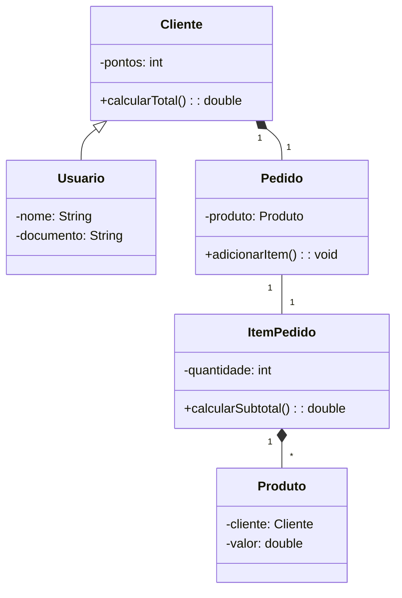

# UC4 — Aula 11 — Casos de uso e diagramas de classes

## Identificação

| Informação | Preenchimento |
|---|---|
| Nome completo | **Andrey Fernandes** |
| Integrante da dupla | **Matheus Epifanio** |
| Turma | **TDS sala 102** |
| Data | **24/09/26** |

## Orientações

Esta atividade utiliza o sistema da loja desenvolvido durante as aulas anteriores.

1. Preencha as respostas diretamente neste arquivo.
2. Substitua todos os campos `Digite aqui` pelas respostas da dupla.
3. Quando solicitado, justifique a resposta usando o código do projeto.
4. No exercício do diagrama, cole a imagem ou informe um link com permissão de visualização.
5. Entregue este arquivo preenchido no Google Classroom.
6. Antes de entregar, confira se o nome da dupla aparece no início do documento.

---

# Exercício 1 — Caso de uso da venda

Descreva o caso de uso **Realizar pedido**. Pense na funcionalidade pelo ponto de vista do cliente, sem explicar telas, botões ou comandos Java.

## 1.1 Identificação do caso de uso

| Item | Resposta |
|---|---|
| Nome do caso de uso | **Realizar pedido** |
| Ator principal | **Cliente** |
| Objetivo do ator | **Realizar o pedido** |
| Resultado esperado | **Ter o pedido realizado com sucesso** |

## 1.2 Pré-condições

O que precisa ser verdadeiro antes do pedido começar?

1. **Cliente ser válido no sistema**
2. **Produto estar cadastrado no estoque**
3. **O sistema estar funcionando**

## 1.3 Fluxo principal

Descreva o caminho em que tudo acontece corretamente. Use entre sete e nove passos.

| Passo | Ação do ator ou resposta do sistema |
|---:|---|
| 1 | **Usuário se cadastra** |
| 2 | **Usuário inicia um pedido** |
| 3 | **O usuário seleciona um produto que esteja no estoque** |
| 4 | **Seleciona a quantidade desejada do produto** |
| 5 | **O sistema devolve com o valor do pedido** |
| 6 | **O usuário seleciona um metódo de pagamento disponível** |
| 7 | **O sistema deve retornar se o pagamento foi aceito** |
| 8 | **Caso aceito o pagamento, o pedido foi finalizado** |
| 9 | **Caso não seja aceito o pagamento, o sistema retorna informando que houve um problema** |

## 1.4 Fluxos alternativos

Descreva pelo menos duas situações em que o fluxo principal não pode continuar normalmente.

| Situação | Em qual passo acontece? | Como o sistema deve responder? |
|---|---:|---|
| **Usuário não é valido ou cadastrado** | **No segundo passo** | **O sistema retorna avisando que o usuário é invalido** |
| **Produto não está em estoque** | **No terceiro passo** | **O sistema deve retornar que o produto selecionado é inválido** |

## 1.5 Pós-condições

Como o sistema deve estar depois que o caso de uso terminar corretamente?

1. **Um usuário novo é cadastrado**
2. **Deve existir um pedido novo realizado**
3. **O pagamento deve ser concluído de forma válida**

## 1.6 Regras de negócio

Registre pelo menos duas regras que o sistema precisa respeitar.

1. **O usuário deve estar cadastrado**
2. **O produto deve estar em estoque**

---

# Exercício 2 — Radiografia da classe `Pedido`

Analise a classe `Pedido` do projeto e identifique o que o código revela sobre seus relacionamentos.

## 2.1 Relacionamentos encontrados

| Classes relacionadas | Tipo de relacionamento | Multiplicidade | Evidência encontrada no código |
|---|---|---|---|
| `Pedido` e `Cliente` | **Um cliente pode ter vários pedidos, mas pedidos pode ter apenas um cliente** | **(Cliente 1, pedido 0..*)** | **O Pedido possui um atributo do tipo Cliente, indicando que cada pedido pertence a um cliente** |
| `Pedido` e `ItemPedido` | **Um pedido pode ter muitos ItemPedido, mas o itemPedido precisa de um Pedido** | **(Pedido 1, ItemPedido 0..*)** | **Digite aqui:** |
| `ItemPedido` e `Produto` | **Um produto pode estar em vários ItemPedido, mas cada ItemPedido está relacionado a apenas um produto** | **(Produto 1 -> ItemPedido 0..*)** | **O ItemPedido possui um atributo do tipo Produto, indicando que cada item está relacionado a um produto.** |

## 2.2 Justificativas

### A. Por que `Pedido` e `Cliente` não formam uma composição?

> **Resposta:** Porque Cliente pode existir sem depender de pedido, mesmo que um pedio seja excluido o cliente ainda existirá.

### B. Por que `Pedido` e `ItemPedido` podem ser representados por composição?

> **Resposta:** Porque o ItemPedido depende de Pedido, se o pedido for excluido, seus itens tambem deixam de existir, pois não faz sentido continuarem existindo.

### C. Por que `ItemPedido` conhece um `Produto`, mas não controla a existência dele?

> **Resposta:** Porque o Produto pode existir indempendentemente do ItemPedido, Pedido continua existindo mesmo que seus itens sejam excluidos.

### D. No código atual, um `Pedido` pode ser criado sem itens. Qual multiplicidade representa essa situação: `0..*` ou `1..*`? Justifique.

> **Resposta:** 0..* porque significa que pode ser 0 ou mais, se fosse 1..* significaria que deve ter no minimo um ou mais, sem possibilidade de ser 0.

### E. O que precisaria mudar no código para podermos afirmar que todo pedido possui pelo menos um item?

> **Resposta:** no arquivo Pedido.java Seria preciso alterar o construtor para que ele valide Se Pedido esta sendo criado com no minimo um ItemPedido.

# Exercício 3 — Diagrama de classes da loja

Crie um diagrama de classes que represente o projeto atual.

O diagrama deve conter:

- `Usuario`;
- `Cliente`;
- `Pedido`;
- `ItemPedido`;
- `Produto`;
- atributos essenciais;
- métodos de negócio;
- visibilidade dos membros;
- relacionamentos;
- multiplicidades.

## 3.1 Planejamento das classes

Preencha a tabela antes de desenhar.

| Classe | Responsabilidade | Atributos essenciais | Métodos de negócio |
|---|---|---|---|
| `Usuario` | **Representa o usuário no sistema** | **nome e documento** | **exibirDados()** |
| `Cliente` | **Representa o cliente no sistema** | **nome, codigo, pontos e documento** | **exibirDados()** |
| `Pedido` | **Representa o pedido no sistema** | **cliente** | **calcularSubtotal()** |
| `ItemPedido` | **Representa um produto dentro de um pedido com quantidade** | **produto e quantidade** | **calcularSubtotal()** |
| `Produto` | **Representa o produto no sistema** | **nome, preco, quantidade** | **calcularValorTotal()** |

## 3.2 Planejamento dos relacionamentos

| Origem | Destino | Relação | Multiplicidade | Justificativa |
|---|---|---|---|---|
| Cliente | Usuario | **Hernaça** | **1 ->** | **Cliente é um tipo de Usuario e pode herdar seus atributos e métodos.** |
| Cliente | Pedido | **Associação** | **1 -> 0..** | **Um cliente pode realizar vários pedidos, enquanto cada pedido pertence a um cliente.** |
| Pedido | ItemPedido | **Composição** | **1 -> 0..** | **Um pedido possui seus itens, e os ItemPedido dependem do pedido para fazer sentido.** |
| ItemPedido | Produto | **Associação** | **0.. -> 1** | **Um ItemPedido está relacionado a um produto, mas o produto pode existir independentemente dos itens dos pedidos.** |


## 3.4 Conferência

Marque depois de revisar o diagrama:

- [ ] Usei apenas classes existentes no projeto.
- [ ] Os atributos pertencem às classes corretas.
- [ ] Os métodos representam responsabilidades reais.
- [ ] A herança aponta de `Cliente` para `Usuario`.
- [ ] A composição está entre `Pedido` e `ItemPedido`.
- [ ] As multiplicidades representam o código atual.
- [ ] O diagrama não inventa atributos apenas para parecer completo.

---

# Exercício 4 — Diagrama com bugs

Uma dupla tentou representar o sistema da loja e produziu o modelo abaixo. Ele possui erros de herança, responsabilidade, relacionamento e multiplicidade.



Caso o seu editor não mostre o desenho, leia as relações do diagrama assim:

```text
Usuario ─────▷ Cliente

Cliente    1 ◆──────── 1 Pedido
Pedido     1 ───────── 1 ItemPedido
ItemPedido 1 ◆──────── * Produto
```

## 4.1 Encontre os problemas

Localize e explique pelo menos cinco erros.

| Erro encontrado | Como deveria ficar | Justificativa baseada no código ou na regra de negócio |
|---|---|---|
| 1. **Sentido da herança está invertido** | **(Cliente <-- Usuario)** | **O usuário é o pai, mas a flecha aponta para o filho** |
| 2. **Responsabilidade do cálculo do total (Cliente.calcularTotal())** | **O método calcularTotal() deve ficar na classe Pedido.** | **O cálculo deve pertencer ao pedido pois lá tem os valores** |
| 3. **Composição e Multiplicidade entre Cliente e Pedido** | **Cliente 1; pedido 0..*** | **Um cliente pode fazer vários pedidos, O uso de (*--) está errado porque o cliente é destruído se o pedido deixar de existir, e vice-versa.** |
| 4. **Multiplicidade entre Pedido e ItemPedido** | **Pedido 1; itemPedido 0..*** | **Podem existir vários produto itemPedido para um Pedido** |
| 5. **Relacionamento e Responsabilidade entre ItemPedido e Produto** | **Pedido(◆--) Item pedido** | **Digite aqui:** |
| 6. **Produto possui uma relação direta com Cliente** | **O atributo cliente deveria ser removido de Produto.** | **O cliente se relaciona com o Pedido, e não diretamente com o produto. Um mesmo produto pode ser vendido para vários clientes por meio de diferentes pedidos.** |


## 4.3 Escolha mais importante

Qual correção foi a mais importante para o entendimento do sistema? Explique.

> **Resposta:** Digite aqui.

---

# Reflexão final

## 1. Qual parte foi mais fácil: compreender o caso de uso ou compreender as classes? Por quê?

> **Resposta:** Digite aqui.

## 2. Qual relacionamento ainda causa dúvida na dupla?

> **Resposta:** Digite aqui.

## 3. Em uma frase, explique por que o código e o diagrama precisam concordar.

> **Resposta:** Digite aqui.

---

# Conferência antes da entrega

- [ ] Preenchemos a identificação da dupla.
- [ ] Respondemos todas as partes do exercício 1.
- [ ] Justificamos os relacionamentos do exercício 2.
- [ ] Inserimos a imagem ou o link do diagrama do exercício 3.
- [ ] Encontramos pelo menos cinco erros no exercício 4.
- [ ] Inserimos a imagem ou o link do diagrama corrigido.
- [ ] Respondemos à reflexão final.
- [ ] Conferimos se os links possuem permissão de visualização.

## Nome sugerido para o arquivo

`aula-11-diagramas-nome1-nome2.md`